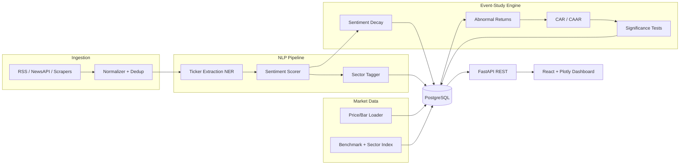
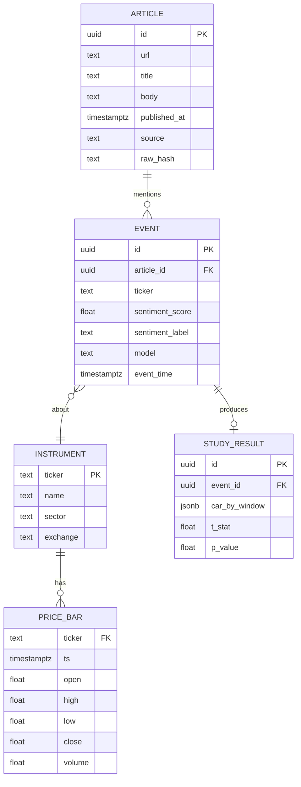

# News Sentiment + Price Reaction Engine — Project Plan

A full-stack financial **event-study platform** that ingests news, extracts the
tickers each story is about, scores sentiment, timestamps the event, and then
measures the market's reaction using **abnormal-return** analysis over
configurable post-news windows. The goal is to go beyond an "API wrapper" and
deliver a defensible, statistically grounded link between *what was said* and
*what the price did*.

> **Disclaimer:** This is a research/analytics tool. It measures historical
> reactions and correlations. It is **not** investment advice and produces no
> trade signals.

---

## 1. Goals & Scope

| Goal | Description |
|------|-------------|
| Rigorous | Use real event-study methodology (estimation window, abnormal returns, significance tests), not just "price went up/down". |
| Explainable | Every score and return is traceable back to the source article and timestamp. |
| Reproducible | Deterministic pipelines; re-running on the same data yields the same study. |
| Extensible | Pluggable sentiment models (lexicon → FinBERT) and expected-return models. |

**Out of scope (v1):** intraday tick data (use daily/hourly bars), options &
derivatives reactions, non-English news, real-money trading, paid newswire feeds
(Bloomberg/Reuters) — use free/licensed sources only.

---

## 2. Architecture



**Pattern:** A batch/stream **ingestion** layer feeds a pure-Python **NLP** stage
and an independent **event-study** engine. All quantitative logic lives in
framework-free modules (`core/`) so studies can be run from a notebook, CLI, or
the API identically.

---

## 3. Tech Stack

| Layer | Choice | Purpose |
|-------|--------|---------|
| Language | Python 3.11+ | Pipelines + analytics |
| API | FastAPI + Uvicorn | Async REST, OpenAPI docs |
| Validation | Pydantic v2 | Request/response schemas |
| NLP (baseline) | VADER + finance lexicon (Loughran–McDonald) | Fast, transparent sentiment |
| NLP (advanced) | FinBERT (HuggingFace transformers) | Context-aware financial sentiment |
| NER / tickers | spaCy + cashtag/regex + company→ticker map | Entity → ticker resolution |
| Market data | yfinance / Stooq / Tiingo (pluggable) | Daily & hourly bars |
| Numerics | NumPy, pandas, SciPy, statsmodels | Returns, regressions, t-tests |
| Storage | PostgreSQL 15 + SQLAlchemy 2 + Alembic | Articles, events, prices, studies |
| Cache/queue | Redis (optional) | Dedup, rate-limit, job queue |
| Scheduler | APScheduler / Celery | Periodic ingestion & studies |
| Frontend | React (Vite + TypeScript) | Dashboard |
| Charts | Plotly.js | CAR curves, scatter, heatmaps |
| Testing | pytest, hypothesis | Unit + property-based |
| Tooling | ruff, black, mypy | Lint, format, type-check |

---

## 4. Repository Structure

```
news-sentiment-engine/
├── PLAN.md                       # this file
├── README.md
├── docker-compose.yml            # postgres + redis + api
├── backend/
│   ├── pyproject.toml
│   ├── alembic/                  # DB migrations
│   ├── app/
│   │   ├── main.py               # FastAPI app + routers
│   │   ├── config.py             # settings (env-driven)
│   │   ├── db.py                 # SQLAlchemy engine/session
│   │   ├── models/               # ORM tables
│   │   │   ├── article.py
│   │   │   ├── event.py
│   │   │   ├── price_bar.py
│   │   │   └── study_result.py
│   │   ├── schemas/              # Pydantic DTOs
│   │   ├── api/
│   │   │   ├── routes_news.py
│   │   │   ├── routes_sentiment.py
│   │   │   ├── routes_events.py
│   │   │   ├── routes_study.py
│   │   │   └── routes_sectors.py
│   │   ├── ingest/               # source adapters
│   │   │   ├── base.py
│   │   │   ├── rss_source.py
│   │   │   ├── newsapi_source.py
│   │   │   └── dedup.py
│   │   ├── nlp/                  # PURE NLP, no FastAPI
│   │   │   ├── tickers.py        # NER + resolution
│   │   │   ├── sentiment.py      # lexicon + FinBERT backends
│   │   │   └── sectors.py
│   │   └── core/                # PURE analytics, no FastAPI
│   │       ├── returns.py        # log/simple returns
│   │       ├── expected_return.py# market/CAPM/mean-adjusted models
│   │       ├── event_study.py    # AR, CAR, AAR, CAAR
│   │       ├── significance.py   # t-tests, BMP, rank tests
│   │       ├── decay.py          # sentiment decay fitting
│   │       └── correlation.py    # sentiment vs return
│   └── tests/
│       ├── test_tickers.py
│       ├── test_sentiment.py
│       ├── test_event_study.py
│       ├── test_significance.py
│       └── test_decay.py
└── frontend/
    ├── package.json
    └── src/
        ├── App.tsx
        ├── api/client.ts
        ├── components/
        │   ├── NewsFeed.tsx
        │   ├── EventTimeline.tsx
        │   ├── CARChart.tsx           # cumulative abnormal return
        │   ├── SentimentReturnScatter.tsx
        │   ├── DecayCurve.tsx
        │   └── SectorHeatmap.tsx
        └── types/api.ts
```

---

## 5. Data Model (PostgreSQL)



---

## 6. The Math (Core Engine)

### 6.1 Returns

Simple and log returns for instrument $i$ on day $t$:

$$R_{i,t} = \frac{P_{i,t} - P_{i,t-1}}{P_{i,t-1}}, \qquad r_{i,t} = \ln\!\frac{P_{i,t}}{P_{i,t-1}}$$

### 6.2 Event windows

For an event at time $\tau$ (the bar in which the news lands), define:

- **Estimation window** $[\tau - L_1 - L_2,\; \tau - L_1)$ — used to fit the
  expected-return model (e.g. 120 trading days ending 10 days before the event).
- **Event window** $[\tau + a,\; \tau + b]$ — e.g. $[-1, +5]$ days around the news.

```mermaid
gantt
    dateFormat X
    axisFormat %s
    section Timeline
    Estimation window :done, est, 0, 120
    Gap               :crit, gap, 120, 10
    Event window      :active, evt, 130, 7
```



### 6.3 Expected (normal) return models

| Model | $E[R_{i,t}]$ |
|-------|--------------|
| Mean-adjusted | $\bar{R}_i$ (avg over estimation window) |
| Market-adjusted | $R_{m,t}$ (benchmark return) |
| **Market model** | $\hat\alpha_i + \hat\beta_i R_{m,t}$ (OLS on estimation window) |
| CAPM | $R_f + \hat\beta_i (R_{m,t} - R_f)$ |

The **market model** is the default: estimate $\alpha_i,\beta_i$ via OLS of
$R_{i,t}$ on $R_{m,t}$ over the estimation window.

### 6.4 Abnormal & cumulative abnormal returns

$$AR_{i,t} = R_{i,t} - E[R_{i,t}]$$

$$CAR_i(a,b) = \sum_{t=\tau+a}^{\tau+b} AR_{i,t}$$

Aggregating across $N$ events:

$$\overline{AR}_t = \frac{1}{N}\sum_{i=1}^{N} AR_{i,t}, \qquad
CAAR(a,b) = \sum_{t=a}^{b} \overline{AR}_t$$

### 6.5 Significance testing

Standardized test using estimation-window residual variance $\hat\sigma_{AR_i}^2$:

$$t_{CAR_i} = \frac{CAR_i(a,b)}{\sqrt{(b-a+1)\,\hat\sigma_{AR_i}^2}}$$

Cross-sectional test for the average effect:

$$t_{CAAR} = \frac{CAAR(a,b)}{\widehat{SD}(CAR)/\sqrt{N}}$$

Also offer the **non-parametric rank test** and **BMP (standardized
cross-sectional)** test to guard against event-induced variance and non-normality.

### 6.6 Sentiment scoring

- **Lexicon baseline:** signed, tone-weighted count using the Loughran–McDonald
  finance dictionary; polarity in $[-1, 1]$.
- **FinBERT:** softmax over {positive, neutral, negative}; score
  $s = p_{\text{pos}} - p_{\text{neg}} \in [-1, 1]$ with confidence $\max_k p_k$.

### 6.7 Sentiment decay over time

Model how the *informational value* of sentiment fades after publication by
fitting an exponential decay to abnormal returns conditioned on day-0 sentiment:

$$\text{effect}(\Delta t) = s_0\, e^{-\lambda \Delta t}, \qquad
t_{1/2} = \frac{\ln 2}{\lambda}$$

Estimate $\lambda$ by nonlinear least squares on $|\overline{AR}_t|$ versus event
time; report the **half-life** of the reaction.

### 6.8 Sentiment ↔ return correlation

Pearson and Spearman correlation between day-0 sentiment $s_i$ and forward
abnormal returns $CAR_i(0,h)$ for horizons $h \in \{1,3,5,10\}$, with
bootstrapped confidence intervals.

### 6.9 Sector-level sentiment

Aggregate event sentiment to GICS-style sectors:

$$S_{\text{sector}}(d) = \frac{\sum_{i \in \text{sector}} w_i\, s_i}{\sum_{i} w_i}, \qquad
w_i = \text{(recency} \times \text{source credibility)}$$

Compare sector sentiment indices against sector ETF abnormal returns.

---

## 7. Pipelines

1. **Ingestion** — poll sources → normalize (strip HTML, canonical URL) →
   `raw_hash` dedup → persist `ARTICLE`.
2. **Extraction** — NER + cashtag regex → resolve company names to tickers →
   create one `EVENT` per (article, ticker).
3. **Scoring** — sentiment backend tags each event; sector tagger labels it.
4. **Market join** — load bars for the ticker + benchmark around `event_time`.
5. **Study** — fit expected-return model, compute AR/CAR, run significance
   tests, persist `STUDY_RESULT`.
6. **Aggregation** — refresh CAAR, decay fits, and sector indices on a schedule.

---

## 8. API Design (REST)

| Method | Endpoint | Body → Returns |
|--------|----------|----------------|
| POST | `/api/news/ingest` | source config → count ingested |
| GET  | `/api/news` | filters (ticker, date) → articles |
| POST | `/api/sentiment/score` | text → score + label + model |
| GET  | `/api/events` | ticker/date filters → events |
| POST | `/api/study/run` | ticker, window, model → AR/CAR + stats |
| POST | `/api/study/aggregate` | event set → CAAR curve + t-stats |
| GET  | `/api/study/decay` | ticker/sector → λ + half-life |
| GET  | `/api/correlation` | horizon → sentiment-vs-return ρ + CI |
| GET  | `/api/sectors/sentiment` | date range → sector index series |

FastAPI auto-generates Swagger docs at `/docs`.

---

## 9. Frontend Features

- **News Feed** — live list with ticker chips, sentiment badge, source, time.
- **Event Timeline** — events plotted on a price chart at their timestamps.
- **CAR Chart** — average cumulative abnormal return across event window with
  confidence band and significance markers.
- **Sentiment vs Return Scatter** — day-0 sentiment vs forward CAR, fitted line + ρ.
- **Decay Curve** — abnormal-return magnitude vs event-time with fitted half-life.
- **Sector Heatmap** — sector × day sentiment intensity grid.

---

## 10. Validation & Testing

- **Golden event tests** — known historical events (earnings beats/misses) must
  reproduce expected CAR direction and significance.
- **Property tests** — AR sums to CAR; mean-adjusted model on flat prices yields
  zero AR; permutation of articles doesn't change deterministic scores.
- **Leakage guard** — estimation window must never overlap the event window;
  enforced in code and tested.
- **NLP eval** — labeled sample to track sentiment accuracy/F1 per backend.

---

## 11. Roadmap

| Phase | Deliverable |
|-------|-------------|
| 0 | Repo, Docker, DB schema, migrations |
| 1 | Ingestion + dedup + article store |
| 2 | Ticker NER + lexicon sentiment |
| 3 | Price loader + market-model event study + tests |
| 4 | Significance tests + CAAR aggregation |
| 5 | FinBERT backend + sector tagging |
| 6 | Decay fitting + correlation analysis |
| 7 | React dashboard (feed, CAR, scatter, decay, sectors) |
| 8 | Scheduler, caching, polish, README + demo |

---

## 12. Resume Bullet

> Built a financial news **event-study platform** that extracts tickers, scores
> sentiment (lexicon + FinBERT), and analyzes post-news **abnormal returns** over
> configurable windows — including CAAR significance testing, sentiment **decay
> half-life**, and **sector-level** sentiment indices.
