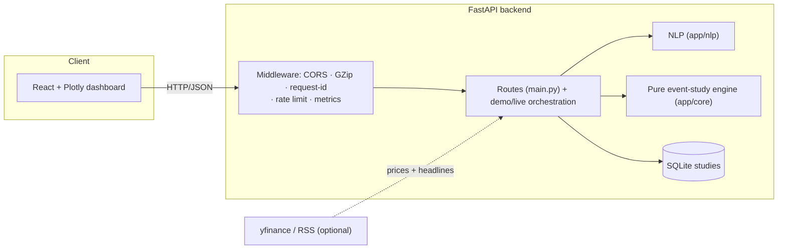
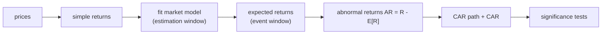

# Architecture

This document explains how the News Sentiment + Price Reaction Engine is built:
the pure event-study core, the market-model estimation, the abnormal-return
statistics (including the Patell/BMP standardized tests), the NLP layer, and the
API/persistence around them.

> For *what* it does and how to run it, see the [README](../README.md); for the
> derivations, see [PLAN.md](../PLAN.md). This document is the *how and why*.

> Research/analytics tool only — it produces no trade signals.

---

## 1. Design goals

1. **A pure event-study engine.** Everything in `app/core/` is plain NumPy/SciPy
   with no FastAPI and no I/O; the API, dashboard, live adapter, and tests share it.
2. **No look-ahead.** The market model is estimated on a window that ends *before*
   the event window, and overlap is rejected, so expected returns never peek at
   the event.
3. **Rigorous significance.** Beyond a plain t-test, the engine offers
   non-parametric (Wilcoxon, sign) and the gold-standard **standardized** event
   tests (Patell, BMP).

---

## 2. System overview



`app/core` never imports the API layer.

---

## 3. The event-study pipeline



For a single event (`core/event_study.py`):

- **Estimation window** `[event - gap - L_est, event - gap)` fits the market model
  `R_asset = alpha + beta * R_market + e` (`core/expected_return.py`), yielding the
  residual standard deviation `s`.
- **Event window** `[event - pre, event + post]` gives expected returns from the
  fitted model; **abnormal returns** are the residuals, and **CAR** is their
  cumulative sum.
- Overlap between the windows is rejected to prevent leakage.

Across many events (`aggregate_caar`), per-day **AAR** and cumulative **CAAR** are
formed with a cross-sectional test.

---

## 4. Significance tests

| Test | Module | Idea |
| ---- | ------ | ---- |
| CAR t-test | `significance.py` | `CAR / (s * sqrt(L))` vs Student-t |
| Cross-sectional CAAR t | `significance.py` | mean CAR / its cross-sectional SE |
| Wilcoxon / sign | `significance.py` | non-parametric, robust to outliers |
| Bootstrap CAAR CI | `bootstrap.py` | percentile CI for the mean CAR |
| **Patell (1976)** | `standardized_tests.py` | sum of standardized CARs / sqrt(summed variances), ~ N(0,1) |
| **BMP (1991)** | `standardized_tests.py` | mean standardized CAR / its cross-sectional sd — robust to event-induced variance |

The **standardized** tests are the upgrade: each event's CAR is divided by its own
forecast standard error (`CAR / (s * sqrt(L))`) before aggregation, so precise
events count for more (Patell) and event-induced volatility is handled (BMP).

Reaction **decay** (`core/decay.py`) fits an exponential to the post-event AR to
estimate a half-life, and **correlation** (`core/correlation.py`) relates
sentiment to forward CAR.

---

## 5. NLP layer

- **Sentiment** (`nlp/sentiment.py`) — a VADER-style lexicon scorer returning a
  polarity score, a label, and the number of lexicon hits.
- **Ticker extraction** (`nlp/tickers.py`) — cashtags plus a curated company-name
  map.

These are deliberately dependency-light; FinBERT / spaCy NER are roadmap drop-ins
behind the same interfaces.

---

## 6. API, persistence & operations

Routes (`main.py`) stay thin; orchestration is in `demo.py` (synthetic dataset)
and `live.py` (optional yfinance prices + RSS headlines with synthetic fallback).
Studies persist to **SQLite** (`persistence/store.py`). Cross-cutting concerns:

- **Observability** — `GET /api/version`, `/api/ready`, Prometheus `/metrics`;
  request-id + latency + security headers; structured logs.
- **Resilience** — GZip, CORS, an optional per-IP rate limiter, a global error
  envelope.
- **Config** — env-driven (`CORS_ORIGINS`, `LOG_LEVEL`, `RATE_LIMIT_PER_SEC`,
  `STUDIES_DB`).

---

## 7. Module map

```
backend/app/
  core/
    returns.py            # simple / log returns
    expected_return.py    # market-model fit + expected returns
    event_study.py        # AR / CAR / CAAR (estimation + event windows)
    significance.py       # t-test, cross-sectional t, Wilcoxon, sign
    standardized_tests.py # Patell (1976) + BMP (1991)
    bootstrap.py          # percentile bootstrap CI for mean CAR
    decay.py              # exponential reaction-decay fit (half-life)
    correlation.py        # sentiment vs forward CAR
    report.py             # standalone HTML event-study report
  nlp/
    sentiment.py          # lexicon sentiment scorer
    tickers.py            # cashtag + company-map ticker extraction
  data/synthetic.py       # reproducible market + sentiment-driven events
  demo.py · live.py       # orchestration (synthetic + yfinance/RSS)
  persistence/store.py    # SQLite study store
  schemas.py · main.py · observability.py · config.py
  static/                 # Plotly dashboard
frontend/                 # React + Vite + TypeScript
scripts/bench.py          # event study + Patell/BMP throughput benchmark
```

**Dependency rule:** `api/demo/live → core/nlp`; `core` never imports the API layer.

---

## 8. Testing strategy

- **No look-ahead** — overlapping estimation/event windows are rejected.
- **Event-study identities** — AR sums to CAR; CAAR aggregates per-day AAR.
- **Significance** — the standardized tests are strongly significant for
  consistent positive CARs, near-zero for null CARs, and the length-mismatch /
  zero-variance edge cases are guarded.
- **NLP** — sentiment polarity signs and ticker extraction on known text.
- **API** — every endpoint via FastAPI's `TestClient`.

CI (GitHub Actions) runs ruff + pytest (coverage) on the backend, a type-checked
Vite build on the frontend, and validates the compose file.
